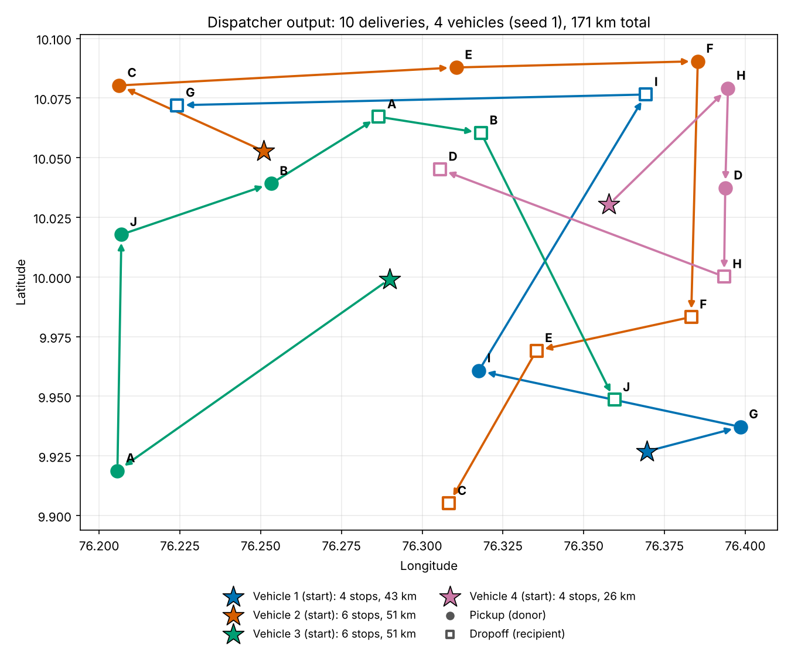

# Real-Time Dynamic Route Optimizer

Real-time route optimization for distributed logistics. Vehicles and delivery stops are streamed in, and routes are re-optimized continuously by background workers.

## Background
This project grew out of SustainEats, my K-DISC Young Innovators Programme
idea: a platform connecting restaurants, cafes and grocery stores that have
surplus food with people and organizations in need, with deliveries
coordinated by the app. SustainEats is at concept/prototype stage. This repo
is a standalone engine for its hardest backend problem: dispatching and
re-optimizing deliveries in real time.

## Features
- FastAPI service with Pydantic-validated request and response models
- In-memory state engine with O(1) lookups and a memoized haversine distance matrix
- Capacity-checked, lock-guarded stop assignment
- Cheapest-insertion dispatch plus 2-opt route improvement
- Pickup→dropoff deliveries: donor visited before recipient, on the same vehicle
- Capacity tracked as a load profile along the route (load rises at pickup, falls at dropoff)
- Expiry deadlines checked against an ETA estimate (assumed 30 km/h, no loading time); expired deliveries are marked `failed`
- Load-balanced dispatch: cost = extra km + a per-stop penalty on long routes, scaled by `priority` (urgent items care less about balance)
- Asyncio background worker that drains a pending queue

## Example output

The dispatcher's routes for 10 seeded deliveries and 4 vehicles in a city-sized area
(about 22 km square). Stars are vehicle start positions, circles are donor pickups and
squares are recipient dropoffs; matching letters pair the two ends of a delivery. Arrows
show visit order, and every pickup comes before its dropoff. Regenerate with
`pip install matplotlib && python docs/make_demo.py`.

## Tech Stack
Python 3.14 · FastAPI · Pydantic v2 · asyncio · pytest

## Project Structure
    app/
      schemas.py     # Pydantic models
      state.py       # in-memory state engine
      optimizer.py   # insertion (single and pair), feasibility, 2-opt
      worker.py      # asyncio dispatch worker
      main.py        # FastAPI endpoints
    benchmarks/
      bench.py       # seeded dispatch benchmark (balancing off vs on)
    tests/

## Run Locally
    python -m venv .venv && source .venv/bin/activate
    pip install -r requirements.txt
    pytest -q
    uvicorn app.main:app --reload

Then open `/docs` for the interactive API.

## API
- `POST /vehicles`, `GET /vehicles`, `PUT /vehicles/{id}/location`
- `POST /stops` (returns 202; assignment happens in the background), `GET /stops/{id}`
- `POST /deliveries` (donor pickup + recipient dropoff, optional `expires_at`; returns 202), `GET /deliveries/{id}`
- `GET /routes`, `GET /health`

## Benchmarks
Seeded random workload in a Kerala-sized box: vehicles of capacity 20, deliveries
of demand 1-5, priority 1-5, no expiry. Dispatch only (no HTTP), one delivery at a time
through the same code path as the worker. Single process, CPython, run on a 2-core cloud
sandbox, one run per configuration, so treat timings as indicative and expect
different numbers on your machine. Reproduce with
`python -m benchmarks.bench --vehicles 50 --deliveries 300 --seed 42`
(add `--balanced-only` for 1,000+ deliveries; the unbalanced run gets slow).

**50 vehicles, 300 deliveries (seed 42)**

| Metric | No balancing | Balancing (2 km/stop) |
|---|---|---|
| Longest route | 3,253 km | 493 km |
| Longest route / mean route | 13.8x | 2.1x |
| Most stops on one vehicle | 164 | 28 |
| Idle vehicles | 39 | 10 |
| Total distance | 11,774 km | 11,503 km |
| Mean / p95 dispatch time | 27 ms / 103 ms | 1.1 ms / 2.7 ms |

**20 vehicles, 100 deliveries, two more seeds**

| Seed | Longest/mean (off → on) | Total distance (off → on) |
|---|---|---|
| 1 | 8.4x → 2.0x | 4,138 → 4,539 km (+9.7%) |
| 2 | 8.4x → 2.5x | 3,722 → 3,909 km (+5.0%) |

**50 vehicles, 1,000 deliveries, balancing on (seed 42):** longest route 884 km
(1.35x the mean), at most 50 stops on one vehicle, no idle vehicles, 32,773 km total.

### Dispatch speed
Pair insertion was the bottleneck, so I profiled it and rewrote it. Same machine, same
session, same seeds. The routes produced are identical before and after (same total km,
longest route and stops per vehicle in every row).

| Workload | Before | After | Speedup |
|---|---|---|---|
| 20 vehicles, 100 deliveries, no balancing | 11.5 s (mean 115 ms) | 0.32 s (3.2 ms) | 36x |
| 50 vehicles, 300 deliveries, no balancing | 263 s (mean 875 ms) | 8.0 s (27 ms) | 33x |
| 50 vehicles, 300 deliveries, balancing | 14.8 s (mean 49 ms) | 0.34 s (1.1 ms) | 44x |
| 50 vehicles, 1,000 deliveries, balancing | 379 s (mean 379 ms, p95 1,143 ms) | 7.4 s (mean 7.4 ms, p95 24.5 ms) | 51x |

Larger run, new code only (the old code would take far too long): 100 vehicles, 3,000
deliveries, balancing on: 112 s total, mean 37 ms, p95 143 ms, **worst single dispatch 1.9 s**.

What changed:
1. The extra distance of each candidate slot pair is computed in O(1) from precomputed
   distances, instead of re-measuring the whole candidate route (about 90% of the old runtime).
2. The distance cache is keyed by plain float tuples. Hashing a frozen Pydantic model ran
   Python code on every lookup and was about 45% of the old profile (this overlaps with item 1,
   because most lookups came from re-measuring routes).
3. Feasibility (capacity, pickup-before-dropoff, deadlines) is checked lazily in ascending
   cost order and stops at the first feasible slot pair. Vehicles are visited by ascending
   balance penalty and skipped once the penalty alone exceeds the best cost found, which
   is an exact cut-off because extra distance is never negative.

`tests/test_fast_insertion.py` keeps the original brute-force implementation as an oracle
and checks the new one against it on random states with capacities and deadlines.

Takeaways and limits:
- Pure cheapest insertion piles most work on a few vehicles. Balancing fixes the skew,
  and costs 5-10% extra total distance in two of the three small runs (it was 2% lower in the third).
- Balancing still keeps dispatch cheaper because routes stay short (0.34 s vs 8.0 s for the
  300-delivery run).
- Ranking slot pairs is now O(n²) arithmetic per vehicle (it was O(n³)). Each feasibility check
  is O(n), and usually only a few run, but under tight capacity or deadlines many candidates can
  be infeasible and the worst case is still O(n³).
- Dispatch is synchronous CPU work on the event loop, so the 1.9 s worst case above would
  stall every API request for that long. Moving it off the loop is the next step.
- 10 of 50 vehicles stay idle at 300 deliveries (the 2 km/stop weight is hand-picked, not tuned).
- `priority` only scales the balance penalty; it does not reorder the queue.
  Its behavior is unit-tested but its effect is not benchmarked.

## Roadmap
- [x] Data models and state engine
- [x] Cheapest-insertion + 2-opt optimizer, asyncio dispatch worker
- [x] REST API
- [x] Pickup→dropoff pairing (donor before recipient, same vehicle)
- [x] Expiry deadlines (ETA-based feasibility)
- [x] Load balancing across vehicles
- [x] Priority-scaled dispatch cost
- [x] Benchmarks
- [x] Faster pair insertion and 1,000+ delivery benchmark (up to 51x faster, identical routes)
- [ ] Move dispatch off the event loop to cut worst-case latency
- [ ] Tune the balance weight; priority-ordered queue
- [ ] Redis-backed state for horizontal scaling

## License
MIT